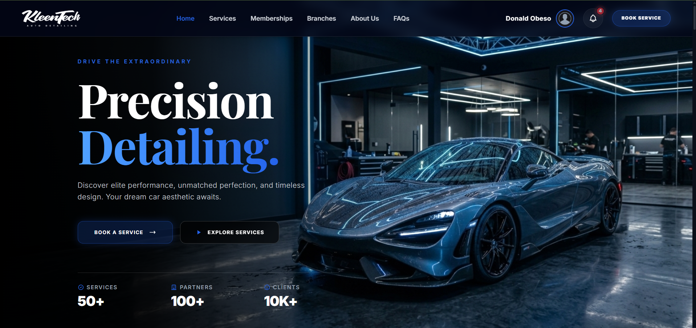
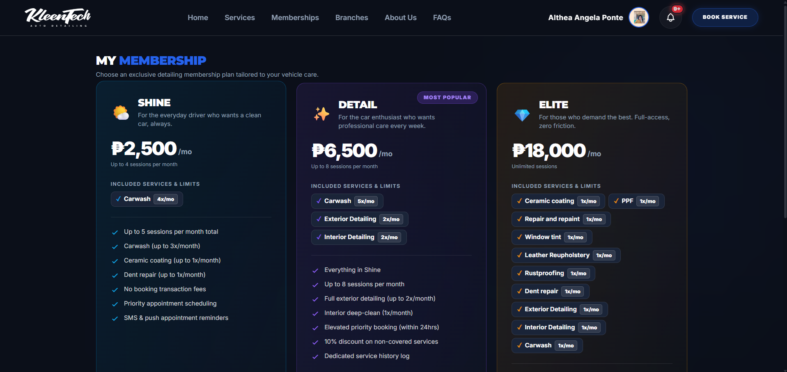
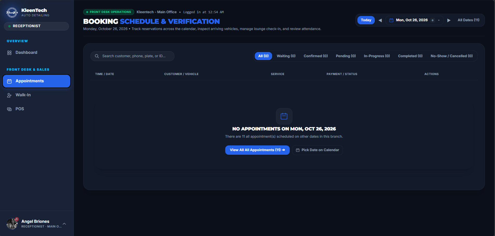
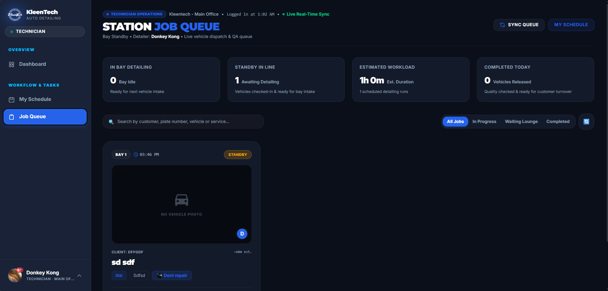
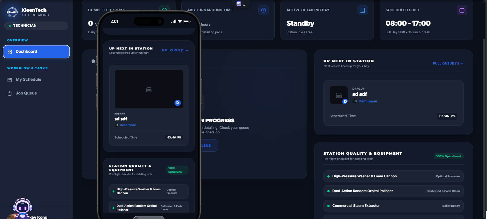
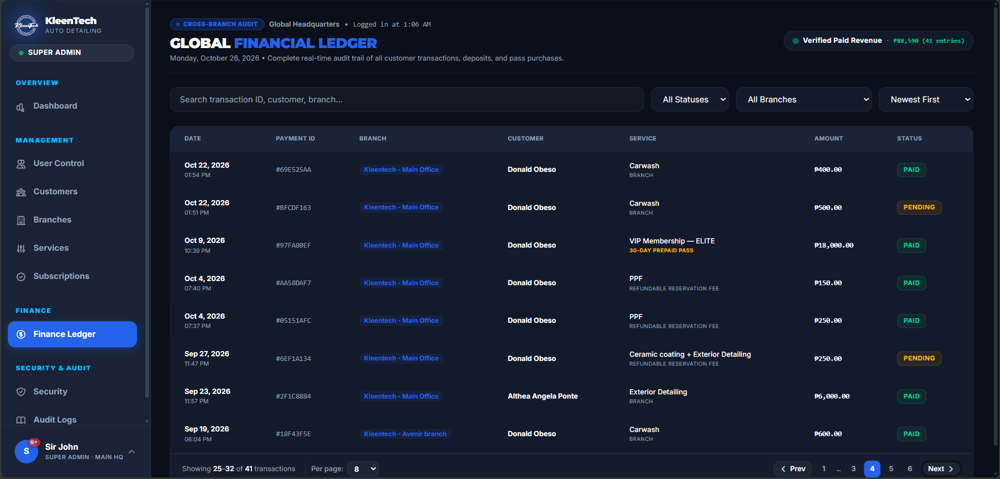
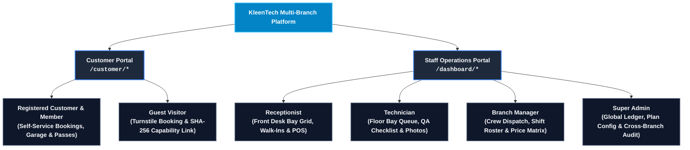

# KleenTech Auto Detailing — Multi-Branch Management Platform

[-f59e0b?style=for-the-badge)]()

A multi-branch operations platform designed for an automotive detailing business across 4 physical branches in the Philippines (*Main Office Cebu*, *Avenir Cebu*, *BYD Alabang*, and *BYD Las Piñas*). Built with **React 19.2**, **TypeScript 6**, **Vite 8**, **Tailwind CSS v4**, **Supabase PostgreSQL 17**, and **PayMongo**, KleenTech coordinates automotive detailing workflows through real-time bay allocation, role-based access control (RBAC) for five roles, an automated 5-step customer booking wizard, and a cashier POS ledger.

> [!NOTE]
> **Architecture Showcase & Development Status (`In Progress`):** This repository contains the public case study, system architecture documentation, TypeScript domain contracts (`types/domain.ts`), and visual showcase assets for the KleenTech platform. The core multi-branch workflows are **implemented and deployed**, while a **6-Milestone Upgrade Roadmap (`M1–M6`)** is **currently in progress** (detailed below). The underlying source implementation is maintained in a private repository.

---

## 🌐 Live Deployment
- **Preview Deployment:** [https://kleentechcapstone.vercel.app/](https://kleentechcapstone.vercel.app/)
- **Infrastructure:** Vercel Global Edge Network with client-side SPA routing, Supabase PostgreSQL 17 database (*29 tables, 59 `SECURITY DEFINER` RPCs, 27 `BEFORE UPDATE` guard triggers*), and 8 Deno Edge Functions.

---

## 📸 System Visual Tour

### 1. Customer Experience & Booking Lifecycle *(Implemented Baseline • Motorcycle Tier & Membership Upgrades In Progress)*
Mobile-responsive portal providing appointment scheduling for both registered users and passwordless guests (via Cloudflare Turnstile and SHA-256 capability links), multi-service bundling (up to 4 services per visit), vehicle registration, and recurring club passes.

| Landing & Precision Detailing | 5-Step Smart Booking Wizard |
| :---: | :---: |
|  |  |

| Live Appointment Tracking & History | Tiered Club Memberships |
| :---: | :---: |
|  |  |

---

### 2. Front Desk Command & POS Cashier *(Implemented Baseline • 3-Stage Document Pipeline In Progress)*
Real-time operations hub for receptionists to monitor physical detailing bays, register walk-ins, coordinate vehicle check-in queues, adjust post-inspection service prices, and settle counter balances.

| Real-Time Detailing Bay Grid (Dark Mode) | POS Cashier & Terminal (Light Mode) |
| :---: | :---: |
|  |  |

---

### 3. Technician Station (Bay Terminal & Mobile Queue) *(Implemented Baseline • Job Order Queue Sync In Progress)*
Dedicated interface engineered for automotive detailers on the service floor. Features a real-time vehicle intake queue, Lead + Co-Technician crew assignments, interactive QA checklists with Undo/Redo history, Before & After photo uploads, and bay stall alerts.

| Station Detailing Bay Terminal | Mobile Field Floor Experience |
| :---: | :---: |
|  |  |

---

### 4. Branch Operations & Workforce Management *(Implemented Baseline • Shop Floor BI Charts In Progress)*
Operational command center for branch managers to dispatch multi-technician crews to bays, configure weekly shift schedules and leave overrides, propose localized branch pricing, and govern daily intake caps.

---

### 5. Executive Governance & Financial Audit *(Implemented Baseline • Executive BI & 3-Segment CRM In Progress)*
Super-admin control plane offering cross-branch visibility into financial transactions, branch price requests, membership plan configuration, staff assignments, IP whitelisting, and audit logs.

---

## 🏗️ Technical Architecture

### Two-Portal Platform & 5-Role Role-Based Access Control (RBAC)
The platform enforces strict separation between public customer booking flows and authenticated staff operations across both the UI layer and the database kernel:

| Persona | Primary Responsibilities | Security Scope |
| :--- | :--- | :--- |
| **Customer / Guest** | Multi-service selection (1–4 packages), slot booking, membership pass redemption, 3-tier self-service cancellation, and payment receipts. | Own user ID & registered vehicles, or verified SHA-256 guest token. |
| **Receptionist** | Real-time bay occupancy, walk-in registration, lounge queues, post-inspection price adjustment, and POS cashiering. | Branch-scoped front desk operations (`branch_id`). |
| **Technician** | Vehicle intake inspection, interactive QA checklist with Undo/Redo, Before/After photo uploads, and stall notices. | Assigned bay & Lead/Co-Technician job queue (`booking_technicians`). |
| **Branch Manager** | Multi-technician bay dispatch, weekly technician rostering, branch service tier pricing requests, and no-show pardon reviews. | Full branch-level operational control (`branch_id`). |
| **Super Admin** | Multi-branch provisioning, master service & membership plan configuration, security settings, and global financial ledger. | Unrestricted cross-branch governance. |

---

## 📊 Feature & Roadmap Status (Implemented vs. In Progress)

### ✅ Already Implemented (Current Baseline)
- **29-Table Supabase PostgreSQL 17 Schema:** Statement-cached RLS (`(SELECT auth.uid())`), 59 `SECURITY DEFINER` RPCs, 27 `BEFORE UPDATE` guard triggers, 8 Deno Edge Functions, and 3 Storage buckets (`user-avatars`, `vehicle-images`, `service-images`).
- **4 Branches & 9 Detailing Services:** Main Office Cebu (all 9 packages) and Avenir Cebu, BYD Alabang, and BYD Las Piñas (4 core packages with localized branch price request workflows).
- **5-Step Omnichannel Booking Wizard:** Authenticated customer & passwordless guest checkout (`create_guest_booking_v1` with SHA-256 capability tokens), 1–4 multi-service bundling (`booking_services`), and PayMongo QRPh/GCash/Maya/GrabPay/Card integration.
- **Dual-Gate Shop Floor Capacity (`evaluate_branch_booking_intake`):** Row-locked (`FOR UPDATE`) validation enforcing both hourly arrival capacity (`hourly_dropoff_capacity`) and daily branch intake limits (`daily_intake_cap`).
- **3-Tier Sliding Cancellation & 2-Strike No-Show Governance:** Automated PayMongo refunds (`>24h: 100%`, `6–24h: 50%`, `<6h: 0%`), `Pay at Branch` lock at 2 no-show strikes, and manager-reviewed pardon appeals (`pardon_requests`).
- **Dual-Channel Notifications:** In-app Realtime WebSocket notifications (`public.notifications`) + Web Push VAPID notifications (`public.device_push_tokens` & `/sw.js`).

### 🚧 Actively In Progress (Milestones M1–M6 Roadmap)
The following 6 milestones have completed architectural specification and are **currently in progress**:
1. **Milestone M1 — 5th Vehicle Tier (`motorcycle`) & Service Compatibility *(In Progress)*:** Expands vehicle tiers (`sedan`, `suv`, `van`, `truck`) to include **`motorcycle`** (`₱100` reservation fee, `0.6x` duration multiplier) and filters out car-only services (*Window Tint*, *Leather Reupholstery*, *Underbody Rustproofing*) via `services.applicable_vehicle_types`.
2. **Milestone M2 — Club Membership Rebrand & Dynamic Quota Engine *(In Progress)*:** Aligns all UI copy and routes (`/customer/membership`, `/dashboard/memberships`) to **Membership**, removes hardcoded plan-slug bypasses, adds **Split-Tender Multi-Service Add-Ons** (`booking_services.covered_by_subscription`), and builds per-service monthly quota meters.
3. **Milestone M3 — 6-State Account Lifecycle, Security & 3-Segment CRM *(In Progress)*:** Auto-claims and merges historical guest/walk-in bookings and deduplicates vehicles by normalized plate upon email verification (`claim_placeholder_records_for_verified_user`), replaces `ON DELETE CASCADE` on financial tables with `ON DELETE RESTRICT` + Soft-Delete PII anonymization, enforces `/staff` Turnstile & first-login password rotation, and segments CRM into **4 Tabs** (`All Clients`, `Active Members`, `Registered Clients`, `Guests & Walk-Ins`) + a **3-Tab Customer 360° Modal**.
4. **Milestone M4 — 3-Stage Document Pipeline, POS & Tech Queue Sync *(In Progress)*:** Transforms `/customer/receipt/:id` across **Stage 1: Job Order (`JO-#`) -> Stage 2: Billing Statement (`INV-#`, with online PayMongo balance checkout & 3-Way Front-Desk Share Suite) -> Stage 3: Official Receipt (`OR-#`)**, adds printable physical `JobOrderSlip`, enforces POS manual confirmation typing on locked post-inspection prices, and synchronizes multi-service bundles & special instructions on the Technician `"Job Order Queue"`.
5. **Milestone M5 — Legal Policies, Shop Floor Waivers & Consent Audit *(In Progress)*:** Adds public `/terms` and `/privacy` pages, an inline `<LegalPolicyModal />`, database consent timestamp columns, and 4-Pillar Philippine legal terms (**RA 10173 Data Privacy Notice**, **Shop Floor Bailment & Damage Waiver**, **Sliding Cancellation & 30-Min No-Show Policy**, and **Membership Fair-Use Rules**).
6. **Milestone M6 — Executive BI & Role Dashboards Overhaul *(In Progress)*:** Moves analytics into `Asia/Manila` (`UTC+8`) PostgreSQL RPCs (`get_executive_analytics_v1`, `get_branch_analytics_v1`) and upgrades all 4 staff dashboards using the `shadcn/ui` `ChartContainer` pattern over `recharts ^3.10.1`.

---

## 🛡️ Database & Security Guardrails
- **PostgreSQL 17 Row-Level Security (RLS):** Every table in `public` has RLS enabled with `(SELECT auth.uid())` statement caching to prevent cross-tenant data leakage.
- **Privilege Escalation Triggers:** `BEFORE UPDATE` database triggers prevent client-side alteration of sensitive columns (`role`, `branch_id`, financial totals, and transaction states).
- **Payment Signature Verification:** PayMongo webhooks verify cryptographic `Paymongo-Signature` via Web Crypto API **HMAC-SHA256** inside Deno Edge Functions before updating order states.
- **Race Condition Prevention:** Detailing bay scheduling enforces row locking (`FOR UPDATE`) inside atomic `SECURITY DEFINER` stored procedures to prevent conflicting bay reservations through database-level locking.

---

## ⚡ Tech Stack & Tools

| Layer | Technology | Purpose |
| :--- | :--- | :--- |
| **Frontend Framework** | React 19.2 + TypeScript 6.0 | Modern component architecture & compile-time type safety. |
| **Styling & Design** | Tailwind CSS v4.0 + Native CSS Tokens | High-contrast dark/light mode with zero runtime CSS-in-JS overhead. |
| **Build & Bundler** | Vite 8.0 | Instant HMR and optimized production treeshaking. |
| **Backend & Database** | Supabase (PostgreSQL 17 + PostgREST) | Serverless data persistence, Realtime WebSocket sync, and Auth. |
| **Edge Functions** | 8 Deno TypeScript Functions | Webhook processing, PayMongo payment intents/refunds, and Web Push. |
| **Quality & E2E** | Vitest + Playwright + GitHub Actions | Unit tests, transactional runtime probes, and multi-role E2E testing. |
| **Hosting** | Vercel Edge Network | Low-latency global static asset delivery and SPA rewrites. |

---

## 📄 License
Copyright © 2026 Donald Obeso. All Rights Reserved.  
This public showcase case study and documentation are shared for portfolio and technical demonstration purposes.
