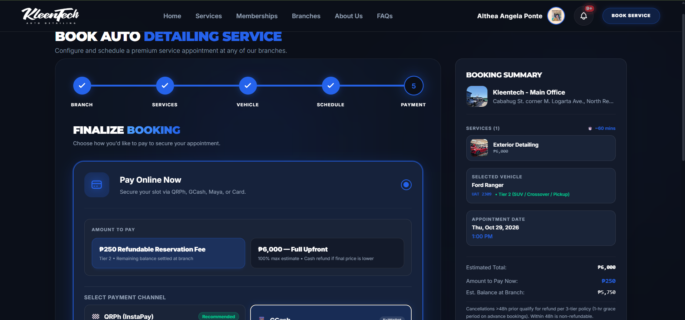
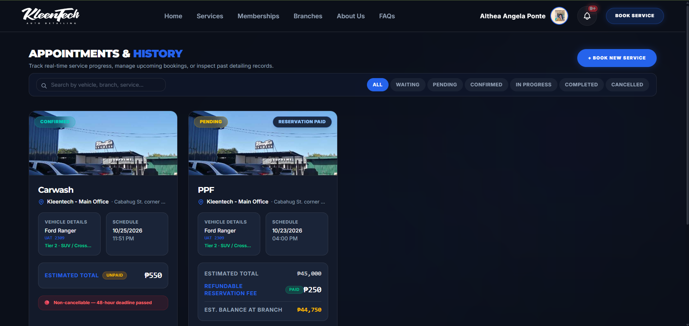

# KleenTech Auto Detailing — Multi-Branch Management Platform

A multi-branch operations platform designed for an automotive detailing business operating across 4 physical branches in the Philippines. Built with **React 19.2**, **TypeScript 6**, **Vite 8**, **Tailwind CSS v4**, **Supabase PostgreSQL 17**, and **PayMongo**, KleenTech coordinates automotive detailing workflows through real-time bay allocation, role-based access control (RBAC) for five authenticated roles, an automated 5-step customer booking wizard, and a cashier POS ledger.

> [!NOTE]
> **Architecture Showcase:** This repository contains the public case study, system architecture documentation, TypeScript domain contracts (`types/domain.ts`), and visual showcase assets for the KleenTech platform. The underlying core production implementation is maintained in a private repository.

---

## 🌐 Live Deployment
- **Preview Deployment:** [https://kleentechcapstone.vercel.app/](https://kleentechcapstone.vercel.app/)
- **Infrastructure:** Vercel Global Edge Network with client-side SPA routing, Supabase PostgreSQL 17 backend, and Deno Edge Functions.

---

## ⚙️ Implemented Core Business Logic & Operational Capabilities

The platform implements 7 integrated operational domains across all 4 branches and 10 detailing, protection, and restoration services:

1. **Sales, Online Booking & Point of Sale (POS):**
   - **5-Step Multi-Service Booking Wizard:** Customers bundle 1 to 4 services per appointment (`Carwash`, `Exterior Detailing`, `Interior Detailing`, `9H Ceramic Coating`, `Paint Protection Film (PPF)`, `Body Repair & Repaint`, `Nano-Ceramic Window Tint`, `Cabin Leather Reupholstery`, `Underbody Bitumen Rustproofing`, and `Paintless Dent Repair`), automatically filtering out car-only packages (`Window Tint`, `Leather Reupholstery`, `Rustproofing`) for motorcycles.
   - **Registered & Passwordless Guest Checkout:** Supports authenticated garage owners and unauthenticated guests (with configurable Cloudflare Turnstile verification and SHA-256 capability tracking links).
   - **5-Tier Vehicle Pricing, Durations & Reservation Deposits:** Computes dynamic `[price_min, price_max]` estimates, duration multipliers (`0.6x` to `1.8x`), and reservation fees (`₱100` to `₱500`) across 5 canonical vehicle tiers (`Motorcycle`, `Sedan / Hatchback`, `SUV / Crossover / Pickup`, `Van / Minibus`, `Long Truck / Heavy`).
   - **Walk-In Registration & Cashier POS:** Front-desk walk-in intake (immediate bay roll-in or scheduled slot), post-inspection final price adjustments, over-the-counter settlement (Cash, Card Terminal, QRPh), online PayMongo checkout (GCash, Maya, GrabPay, QRPh, Card), and printable digital/thermal receipts.
   - **3-Tier Sliding Cancellation & Automated Refunds:** Calculates refund tiers based on notice before the appointment (`> 24h: 100% full refund`, `6–24h: 50% partial refund`, `< 6h: 0% forfeited`) and dispatches refunds via PayMongo.
2. **Operations & Shop Floor Scheduling:**
   - **Multi-Branch Physical Bay Management:** Manages physical detailing bays (`active`, `maintenance`, `inactive`) with real-time bay occupancy synchronized from active booking allocations and tier-scaled busy-slot estimation (`0.6x`–`1.8x`).
   - **Dual-Gate Capacity Intake Engine:** Evaluates **Gate A (Hourly Drop-Off Pacing)** against on-duty technician shifts and lunch windows, and **Gate B (Daily Branch Intake Cap, `1..100`)** under database row locks to prevent shop-floor bottlenecks.
   - **Geolocation Branch Discovery & Live Queues:** Sorts branches by Haversine distance with interactive Leaflet map previews and monitors arriving and waiting lounge queues in real time.
3. **Workforce Dispatch & Bay Execution:**
   - **Multi-Technician Crew Allocation:** Branch Managers assign 1 Lead Technician plus optional Co-Technicians to a bay, automatically splitting estimated job turnaround across the crew (`CEIL(duration / tech_count)`).
   - **Interactive QA Checklists & Photo Proof:** Technicians execute step-by-step service checklists with Undo/Redo history, upload Before & After inspection photos to cloud storage, log technician notes, and send real-time stall/delay notices to the front desk.
4. **Multi-Branch Multi-Tenancy & Price Governance:**
   - **Branch-Level Isolation:** Centralizes all 4 branches in one database while enforcing branch-scoped data visibility for Managers, Receptionists, and Technicians.
   - **Localized Price Approval Workflows:** Branch Managers submit tier-specific price change proposals for their branch, which Super Admins review and approve or reject with automatic audit logging.
5. **Workforce & Shift Scheduling (HR):**
   - **5 Distinct Role Portals:** Dedicated interfaces and permission boundaries for **Customers**, **Receptionists**, **Technicians**, **Branch Managers**, and **Super Admins**.
   - **Shift Templates & Leave Approvals:** Manages weekly technician shift templates, date-specific schedule overrides, daily branch shop-floor routines, technician service specializations, and leave/shift-change requests.
6. **CRM, Club Subscriptions & Strike Governance:**
   - **Customer Vehicle Garage:** Stores customer vehicles with uploaded photos, normalized license plate deduplication, and tier-compatibility guards.
   - **Tiered Club Plans & Expiry Consistency:** Super Admin-configured recurring 30-day plans with custom pricing, perks, monthly service session quotas, and automated overdue period expiry.
   - **2-Strike No-Show & Pardon Appeals:** Tracks customer no-shows, locks `Pay at Branch` privileges at 2 strikes, and allows receptionists to submit pardon appeals for Branch Manager or Super Admin review.
7. **Finance, Notifications & Compliance:**
   - **Dual-Channel Real-Time Notifications:** Dispatches 15 operational event notifications across in-app Supabase Realtime WebSocket feeds and background Web Push VAPID browser/mobile notifications.
   - **Financial Ledgers & Security Controls:** Provides branch and cross-branch payment ledgers, immutable system audit logs (`audit_logs`), WebAuthn Passkey authentication, 5-attempt login lockout protection, and staff IP whitelisting.

---

## 📸 System Visual Tour

### 1. Customer Experience & Booking Lifecycle (In Progress)
Mobile-responsive portal providing appointment scheduling, vehicle registration, and transparent pricing across vehicle tiers.

| Landing Page | 5-Step Booking Wizard |
| :---: | :---: |
|  |  |

| Live Appointment Tracking & History | Tiered Memberships |
| :---: | :---: |
|  |  |

---

### 2. Front Desk Command & POS Cashier (In Progress)
Real-time operations hub for receptionists to monitor physical detailing bays, coordinate vehicle arrivals, and settle counter balances.

| Detailing Bay Grid (Dark Mode) | POS Cashier (Light Mode) |
| :---: | :---: |
|  |  |

---

### 3. Technician Station (Bay Terminal & Mobile Queue)
Dedicated interface engineered for automotive detailers on the service floor. Features real-time vehicle intake queue, bay standby timers, pre-flight equipment checklists, and quality assurance sign-offs.

| Station Bay Terminal | Mobile Queue Interface |
| :---: | :---: |
|  |  |

---

### 4. Branch Operations & Workforce Management
Operational command center for branch managers to allocate weekly staff shifts, adjust vehicle-tier price matrices, and monitor daily bay capacity across detailers.

---

### 5. Executive Governance & Financial Audit (In Progress)
Super-admin control plane offering unified cross-branch visibility into financial transactions, staff assignments, and audit logs.

---

## 🏗️ Technical Architecture

### Two-Portal Platform & 5-Role Role-Based Access Control (RBAC)
The platform enforces strict separation between public customer booking flows and authenticated staff operations across both the UI layer and the database kernel:

| Persona | Primary Responsibilities | Security Scope |
| :--- | :--- | :--- |
| **Customer / Guest** | Multi-service selection, slot booking, club pass redemption, self-service cancellation, and payment receipts. | Own user ID & registered vehicles, or verified SHA-256 guest token. |
| **Receptionist** | Real-time bay occupancy, walk-in registration, lounge queues, post-inspection price adjustment, and POS cashiering. | Branch-scoped front desk operations. |
| **Technician** | Vehicle intake inspection, bay timer tracking, Before/After photo upload, and QA checklist sign-off. | Assigned bay & Lead/Co-Technician job queue. |
| **Branch Manager** | Multi-technician bay dispatch, weekly technician rostering, service tier pricing requests, and branch reports. | Full branch-level operational control. |
| **Super Admin** | Multi-branch provisioning, master catalog & plan configuration, system audit logs, and global financial ledger. | Unrestricted cross-branch governance. |

---

## 🛡️ Database & Security Guardrails
- **PostgreSQL 17 Row-Level Security (RLS):** Every table in `public` has RLS enabled with `(SELECT auth.uid())` statement caching to prevent cross-tenant data leakage.
- **Privilege Escalation Triggers:** `BEFORE UPDATE` database triggers prevent client-side alteration of sensitive columns (`role`, `branch_id`, financial totals, and transaction states).
- **Payment Signature Verification:** PayMongo webhooks verify cryptographic `Paymongo-Signature` via Web Crypto API **HMAC-SHA256** inside Deno Edge Functions before updating order states.
- **Race Condition Prevention:** Detailing bay scheduling enforces row locking (`FOR UPDATE`) inside atomic `SECURITY DEFINER` stored procedures to prevent conflicting bay reservations through database-level locking.

---

## 🚧 Active Roadmap Enhancements (In Progress)
Following completion of the 5-tier vehicle & motorcycle compatibility baseline, upcoming roadmap milestones include:
1. **Mobile UI/UX & Shop-Floor Ergonomics Overhaul *(Next Priority)*:** Mobile-first (`360px`–`430px`) overhaul across the Customer booking wizard, vehicle garage, and self-service portal alongside Technician shop-floor queue, checklist, and schedule ergonomics.
2. **Membership Terminology & Split-Tender Quota Engine:** Standardizing UI terminology from *Subscription* to **Membership**, adding per-service monthly quota progress meters, and supporting Split-Tender checkout when a member bundles covered services with paid add-ons.
3. **Account Lifecycle & 3-Segment CRM:** Automatically merging prior guest/walk-in bookings and deduplicating vehicles when a customer verifies their email, enforcing soft-delete PII anonymization to protect historical payment ledgers, and segmenting CRM into `Active Members`, `Registered Clients`, and `Guests & Walk-Ins` with a 3-tab Customer 360° profile view.
4. **3-Stage Document Pipeline & Technician Job Order Sync:** Evolving `/customer/receipt/:id` across **Stage 1: Job Order (`JO-#`) -> Stage 2: Billing Statement (`INV-#`, with online balance payment & QR/email sharing) -> Stage 3: Official Receipt (`OR-#`)**, adding a printable physical Job Order slip, and syncing multi-service bundles and customer special instructions to the Technician Job Order Queue.
5. **Legal Waivers & Philippine Data Privacy (RA 10173):** Adding dedicated `/terms` and `/privacy` routes, an inline `<LegalPolicyModal />`, Shop Floor Bailment & Damage Waivers, and database consent timestamp tracking.
6. **Server-Side `Asia/Manila` BI Analytics:** Moving historical dashboard aggregations into PostgreSQL `Asia/Manila` (`UTC+8`) RPCs with `shadcn/ui` + Recharts visualizations across Super Admin and Branch Manager consoles.

---

## ⚡ Tech Stack & Tools

| Layer | Technology | Purpose |
| :--- | :--- | :--- |
| **Frontend Framework** | React 19.2 + TypeScript 6.0 | Component architecture & compile-time type safety. |
| **Styling & Design** | Tailwind CSS v4.0 + Native CSS Tokens | High-contrast dark/light mode with zero runtime CSS-in-JS overhead. |
| **Build & Bundler** | Vite 8.0 | Instant HMR and optimized production treeshaking. |
| **Backend & Database** | Supabase (PostgreSQL 17 + PostgREST + Realtime + Storage) | Serverless data persistence, Realtime WebSocket sync, Storage buckets, and Auth. |
| **Edge Functions** | Deno TypeScript Functions | Webhook processing, PayMongo payment intents/refunds, and Web Push VAPID delivery. |
| **Quality & E2E** | Vitest + Playwright + GitHub Actions | Unit tests, runtime behavioral probes, and multi-role E2E testing. |
| **Hosting** | Vercel Edge Network | Low-latency global static asset delivery and SPA rewrites. |

---

## 📄 License
Copyright © 2026 Donald Obeso. All Rights Reserved.  
This public showcase case study and documentation are shared for portfolio and technical demonstration purposes.
