# KleenTech Auto Detailing — Multi-Branch Management Platform

A Multi-branch operations platform designed for an automotive detailing business. Built with **React 19**, **TypeScript**, **Tailwind CSS v4**, and **Supabase PostgreSQL 17**, KleenTech coordinates automotive detailing workflows through real-time bay allocation, role-based access control (RBAC) for five authenticated roles, an automated 5-step customer booking wizard, and a touch-optimized cashier POS ledger.

> [!NOTE]
> **Architecture Showcase:** This repository contains the public case study, system architecture documentation, and visual showcase assets for the KleenTech platform. The underlying core production implementation is maintained in a private repository.

---

## 🌐 Live Deployment
- **Preview Deployment:** [https://kleentechcapstone.vercel.app/](https://kleentechcapstone.vercel.app/)
- **Infrastructure:** Vercel Global Edge Network with client-side SPA routing and Supabase PostgreSQL 17 backend.

---

## 📸 System Visual Tour

### 1. Customer Experience & Booking Lifecycle (In Progress)
Modern, mobile-responsive portal providing frictionless appointment scheduling, vehicle registration, and transparent pricing across vehicle tiers.

| Landing & Precision Detailing | 5-Step Smart Booking Wizard |
| :---: | :---: |
| 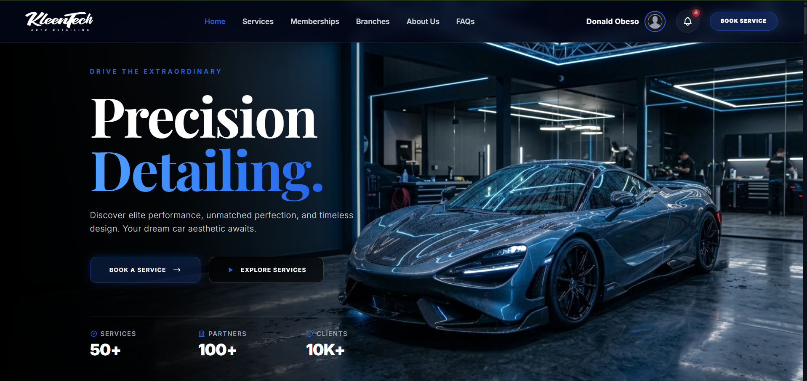 | 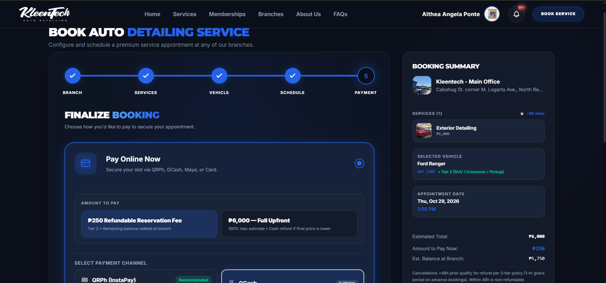 |

| Live Appointment Tracking & History | Tiered VIP Memberships |
| :---: | :---: |
| 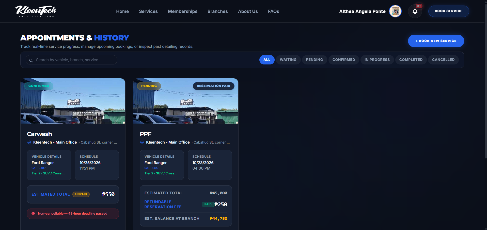 | 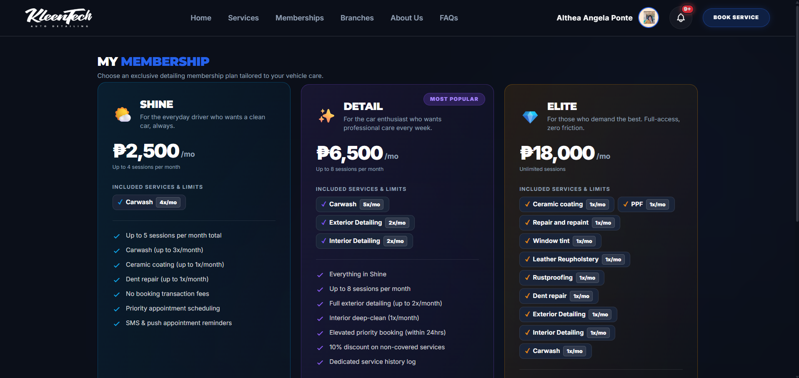 |

---

### 2. Front Desk Command & POS Cashier (In Progress)
Real-time operations hub for receptionists to monitor physical detailing bays, coordinate vehicle arrivals, and settle counter balances.

| Real-Time Detailing Bay Grid (Dark Mode) | POS Cashier & Terminal (Light Mode) |
| :---: | :---: |
| 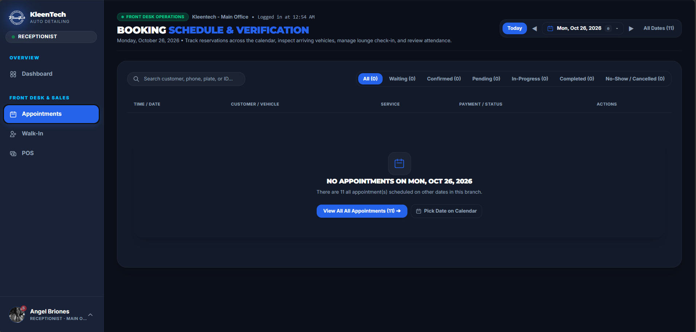 | 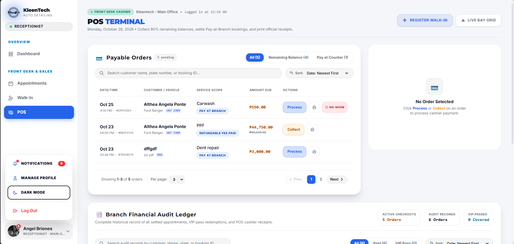 |

---

### 3. Technician Station (Bay Terminal & Mobile Queue)
Dedicated interface engineered for automotive detailers on the service floor. Features real-time vehicle intake queue, bay standby timers, pre-flight equipment checklists, and quality assurance sign-offs.

| Station Detailing Bay Terminal | Mobile Field Floor Experience |
| :---: | :---: |
| 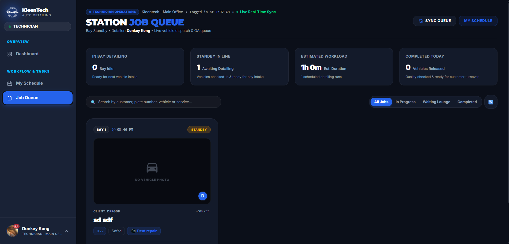 | 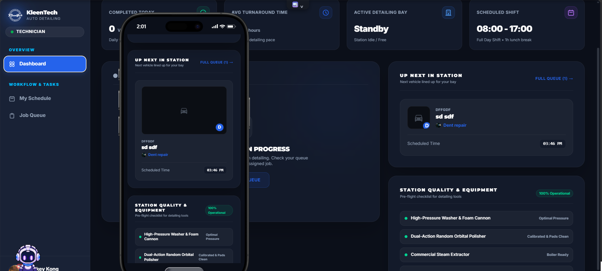 |

---

### 4. Branch Operations & Workforce Management
Operational command center for branch managers to allocate weekly staff shifts, adjust vehicle-tier price matrices, and monitor daily bay capacity across detailers.

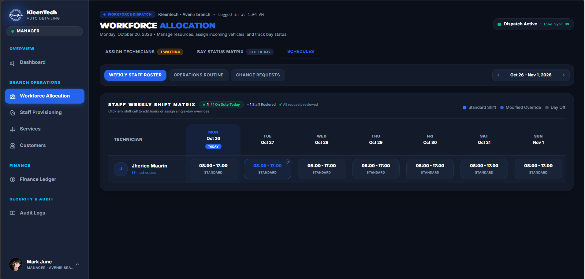

---

### 5. Executive Governance & Financial Audit (In progress)
Super-admin control plane offering unified cross-branch visibility into financial transactions, staff assignments, and audit logs.

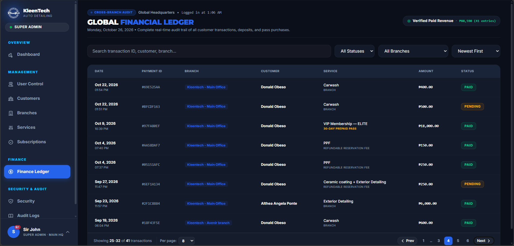

---

## 🏗️ Technical Architecture

### Two-Portal Platform & 5-Role Role-Based Access Control (RBAC)
The platform enforces strict separation between public customer booking flows and authenticated staff operations across both the UI layer and the database kernel:

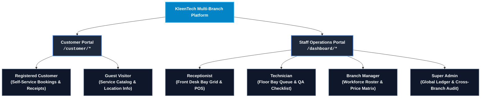

| Persona | Primary Responsibilities | Security Scope |
| :--- | :--- | :--- |
| **Customer** | Service selection, slot booking, membership subscription, payment receipts. | Own user ID & registered vehicles. |
| **Receptionist** | Real-time bay occupancy, walk-in registration, lounge queues, POS cashiering. | Branch-scoped front desk operations. |
| **Technician** | Vehicle intake inspection, bay timer countdown, QA checklist sign-off. | Assigned bay & technician job queue. |
| **Branch Manager** | Weekly technician rostering, service tier pricing, branch revenue reports. | Full branch-level operational control. |
| **Super Admin** | Multi-branch provisioning, system audit logs, global financial ledger. | Unrestricted cross-branch governance. |

---

## 🛡️ Database & Security Guardrails
- **PostgreSQL 17 Row-Level Security (RLS):** Every table in `public` has RLS enabled with `(SELECT auth.uid())` statement caching to prevent cross-tenant data leakage.
- **Privilege Escalation Triggers:** `BEFORE UPDATE` database triggers prevent client-side alteration of sensitive columns (`role`, `branch_id`, financial totals, and transaction states).
- **Payment Signature Verification:** PayMongo webhooks verify cryptographic `Paymongo-Signature` via Web Crypto API **HMAC-SHA256** inside Deno Edge Functions before updating order states.
- **Race Condition Prevention:** Detailing bay scheduling enforces row locking (`FOR UPDATE`) inside atomic `SECURITY DEFINER` stored procedures to prevent conflicting bay reservations through database-level locking.

---

## ⚡ Tech Stack & Tools

| Layer | Technology | Purpose |
| :--- | :--- | :--- |
| **Frontend Framework** | React 19.2 + TypeScript 5.8 | Modern component architecture & compile-time type safety. |
| **Styling & Design** | Tailwind CSS v4.0 + Native CSS Tokens | High-contrast dark/light mode with zero runtime CSS-in-JS overhead. |
| **Build & Bundler** | Vite 8 | Instant HMR and optimized production treeshaking. |
| **Backend & Database** | Supabase (PostgreSQL 17 + PostgREST) | Serverless data persistence, Realtime WebSocket sync, and Auth. |
| **Edge Functions** | Deno TypeScript Functions | Webhook processing, PayMongo payment intents, and Web Push. |
| **Quality & E2E** | Vitest + Playwright + GitHub Actions | Unit tests, and multi-role testing. |
| **Hosting** | Vercel Edge Network | Low-latency global static asset delivery and SPA rewrites. |

---

## 📄 License
Copyright © 2026 Donald Obeso. All Rights Reserved.  
This public showcase case study and documentation are shared for portfolio and technical demonstration purposes.
