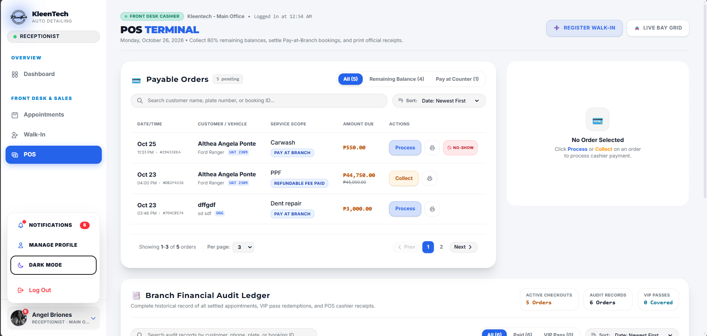
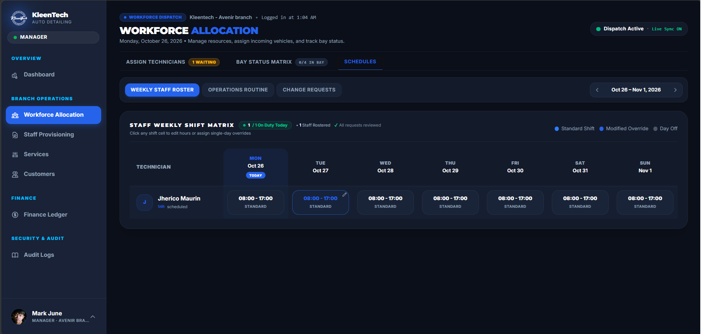
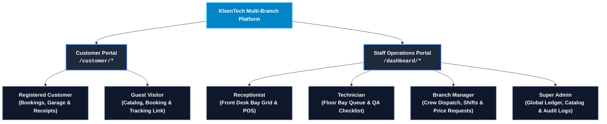

# KleenTech Auto Detailing — Multi-Branch Management Platform

Multi-branch automotive detailing operations platform built for 4 branches in the Philippines using **React 19.2**, **TypeScript 6**, **Vite 8**, **Tailwind CSS v4**, **Supabase PostgreSQL 17**, and **PayMongo**. Coordinates automotive detailing workflows through real-time bay allocation, role-based access control (RBAC) across five authenticated roles, a 5-step customer booking wizard, technician shop-floor execution queues, and a cashier POS ledger.

> [!NOTE]
> **Architecture Showcase:** This public repository contains system documentation, implemented TypeScript domain contracts (`types/domain.ts`), and visual captures of the KleenTech platform. Application source code is maintained in a separate private repository.

---

## 🌐 Live Deployment
- **Preview Deployment:** [https://kleentechcapstone.vercel.app/](https://kleentechcapstone.vercel.app/)
- **Infrastructure:** Vercel Global Edge Network SPA frontend backed by Supabase PostgreSQL 17, Auth, Storage, Realtime, and Deno Edge Functions.

---

## ⚙️ Implemented Operational Capabilities

The platform implements 8 functional areas across 4 branches and 10 detailing, protection, and restoration services:

1. **Sales, Online Booking & Point of Sale (POS):**
   - **5-Step Multi-Service Booking Wizard:** Customers bundle 1 to 4 services per appointment (`Carwash`, `Exterior Detailing`, `Interior Detailing`, `9H Ceramic Coating`, `Paint Protection Film (PPF)`, `Body Repair & Repaint`, `Nano-Ceramic Window Tint`, `Cabin Leather Reupholstery`, `Underbody Bitumen Rustproofing`, and `Paintless Dent Repair`), filtering out car-only packages (`Window Tint`, `Leather Reupholstery`, `Rustproofing`) for motorcycles.
   - **Registered & Passwordless Guest Checkout:** Supports signed-in garage owners and guest bookings with Step 5 Cloudflare Turnstile bot verification when configured and SHA-256 capability tracking links.
   - **5-Tier Vehicle Pricing, Durations & Reservation Deposits:** Computes `[price_min, price_max]` estimates, duration multipliers (`0.6x` to `1.8x`), and reservation fees (`₱100` to `₱500`) across 5 tiers (`Motorcycle / Scooter`, `Sedan / Hatchback`, `SUV / Crossover / Pickup`, `Van / Minibus`, `Long Truck / Heavy Vehicle`).
   - **Walk-In Registration & Cashier POS:** Front-desk walk-in intake (immediate bay roll-in or scheduled slot), post-inspection price adjustments, counter settlement (Cash, Card, E-Wallet/QRPh), online PayMongo checkout (GCash, Maya, GrabPay, QRPh, Card), and printable digital receipts.
   - **3-Tier Sliding Cancellation & Refunds:** Applies a grace window (`<= 1h` after booking and `> 24h` before appointment, gateway fee deducted only), a `10%–50%` linear fee up to `48h` prior, and a `<= 48h` non-cancellable lockout, triggering PayMongo refunds or eligible subscription session returns.
2. **Operations & Shop Floor Scheduling:**
   - **Multi-Branch Physical Bay Management:** Tracks detailing bays (`active`, `maintenance`, `inactive`) with occupancy synced from active booking assignments.
   - **Dual-Gate Capacity & Tier-Scaled Slot Engine:** Evaluates hourly drop-off capacity against technician shifts and lunch breaks alongside a configurable daily intake cap (`1..100`) under database locks, adjusting busy time windows by vehicle tier multipliers (`0.6x`–`1.8x`).
   - **Geolocation Branch Discovery & Live Queues:** Sorts branches by Haversine distance with Leaflet map previews and updates arriving and waiting queues in real time.
3. **Workforce Dispatch & Bay Execution:**
   - **Multi-Technician Crew Allocation:** Branch Managers assign 1 Lead Technician and optional Co-Technicians to a bay, splitting allocated minutes across the crew.
   - **Interactive QA Checklists & Photo Proof:** Technicians track job steps with undo/redo support, capture Before & After inspection photos (`capture="environment"` on mobile devices), record bay notes, and flag stalls/delays to front-desk staff.
4. **Multi-Branch Isolation & Price Governance:**
   - **Branch-Level Data Isolation:** Houses all 4 branches in one database while restricting Managers, Receptionists, and Technicians to their assigned branch.
   - **Localized Price Approval Workflows:** Branch Managers submit tier-specific service price proposals reviewed by Super Admins with automated audit logging.
5. **Workforce & Shift Scheduling (HR):**
   - **5 Role Portals:** Separate application views and PostgreSQL RLS boundaries for **Customers**, **Receptionists**, **Technicians**, **Branch Managers**, and **Super Admins**.
   - **Shift Templates & Leave Approvals:** Manages weekly technician shift schedules, date-specific schedule overrides, daily branch shop-floor routines, service specializations, and shift-change requests.
6. **CRM, Club Subscriptions & Strike Governance:**
   - **Customer Vehicle Garage:** Stores vehicles with uploaded photos, normalized license plate deduplication, and tier-compatibility validation.
   - **Tiered Club Plans & Expiry Enforcement:** Super Admin-configured 30-day recurring plans with custom pricing, perks, monthly session quotas, and overdue period expiration checks.
   - **2-Strike No-Show & Pardon Appeals:** Tracks no-shows, disables `Pay at Branch` privileges after 2 strikes, and lets receptionists submit pardon appeals for Branch Manager or Super Admin review.
7. **Finance, Notifications & Compliance:**
   - **Dual-Channel Real-Time Notifications:** Sends 15 operational event notifications across Supabase Realtime feeds and background Web Push VAPID browser/mobile subscriptions.
   - **Financial Ledgers & Security Controls:** Maintains branch and global payment ledgers, immutable audit logs (`audit_logs`), WebAuthn Passkeys, 5-attempt / 15-minute login lockout protection, and staff IP allowlisting.
8. **Responsive Mobile UI & Shop-Floor Ergonomics (`320px–440px` + Desktop):**
   - **Customer & Technician Mobile Overhaul:** Responsive layouts across landing, 5-step booking wizard, customer portal, shared staff chrome, and technician bay queue/job/schedule views from `320px` compact phones to `440px` phones while preserving desktop workstation views for Receptionist POS, Branch Manager, and Super Admin consoles.
   - **Navigation, Dialogs & Touch Standards:** Shared left slide-over `MobileNavDrawer` reusing compact `NavActionButtons`, unified top-right `UserPortalDropdown`, centered `ModalShell` dialogs with reference-counted body scroll lock and focus trapping, inline collapsible booking summary, `>=44px` interactive controls, zoom-safe `16px` mobile form inputs, and WCAG AA dark/light contrast tokens.

---

## 📸 System Visual Tour

### 1. Customer Experience & Booking Lifecycle
Appointment booking, vehicle management, tracking, and subscription plans across desktop and mobile viewports.

| Landing Page | 5-Step Booking Wizard |
| :---: | :---: |
|  |  |

| Live Appointment Tracking & History | Tiered Memberships |
| :---: | :---: |
|  |  |

---

### 2. Front Desk Command & POS Cashier
Real-time detailing bay grid, arrival intake, price adjustments, and cashier settlement.

| Detailing Bay Grid (Dark Mode) | POS Cashier (Light Mode) |
| :---: | :---: |
|  |  |

---

### 3. Technician Station (Bay Terminal & Mobile Queue)
Bay terminal and mobile floor views for vehicle queues, inspection checklists, timers, and Before/After photo uploads.

| Station Bay Terminal | Mobile Queue Interface |
| :---: | :---: |
|  |  |

---

### 4. Branch Operations & Workforce Management
Branch manager console for technician crew dispatch, shift schedules, and service tier pricing requests.

---

### 5. Executive Governance & Financial Audit
Super-admin console with cross-branch ledgers, catalog configuration, and audit trails.

---

## 🏗️ Technical Architecture

### Two-Portal Platform & 5-Role RBAC
The platform enforces strict separation between public customer booking flows and authenticated staff operations across both routing and PostgreSQL RLS:

| Persona | Primary Responsibilities | Security Scope |
| :--- | :--- | :--- |
| **Customer / Guest** | Multi-service selection, slot booking, club pass redemption, cancellation, and payment receipts. | Own user ID & registered vehicles, or verified SHA-256 guest token. |
| **Receptionist** | Bay occupancy monitoring, walk-in registration, lounge queues, price adjustments, and POS checkout. | Branch-scoped front desk operations. |
| **Technician** | Intake inspection, bay timer tracking, Before/After photo upload, and QA checklist sign-off. | Assigned bay & Lead/Co-Technician queue. |
| **Branch Manager** | Multi-technician bay dispatch, weekly shift schedules, service tier pricing requests, and branch reports. | Full branch-level operational control. |
| **Super Admin** | Multi-branch setup, master service & subscription catalog, audit logs, and cross-branch ledger. | Cross-branch administrative governance. |

---

## 🛡️ Database & Security Guardrails
- **PostgreSQL 17 Row-Level Security (RLS):** All `29` tables in `public` enable RLS with `(SELECT auth.uid())` statement caching to prevent cross-tenant data access.
- **Privilege Escalation & Compatibility Triggers:** Database triggers block client-side modification of `role`, `branch_id`, totals, and states, and reject incompatible vehicle-tier service bookings.
- **Payment Signature Verification:** PayMongo webhooks verify `Paymongo-Signature` with Web Crypto API **HMAC-SHA256** inside Deno Edge Functions before updating payment records.
- **Concurrency & Lockout Protections:** Slot booking and bay allocation use database locks inside atomic `SECURITY DEFINER` RPCs; staff/user authentication enforces 5-attempt / 15-minute lockouts and staff IP allowlisting.

---

## ⚡ Tech Stack & Tools

| Layer | Technology | Purpose |
| :--- | :--- | :--- |
| **Frontend Framework** | React 19.2 + TypeScript 6.0 | Component UI & static type checking. |
| **Styling & Design** | Tailwind CSS v4.0 + Native CSS Tokens | Dual light/dark themes and responsive layout utilities. |
| **Build & Bundler** | Vite 8.0 | HMR development and optimized production bundle. |
| **Backend & Database** | Supabase (PostgreSQL 17 + PostgREST + Realtime + Storage) | Persistence, RLS authorization, Realtime updates, Storage, and Auth. |
| **Edge Functions** | Deno TypeScript Functions | PayMongo intents/checkouts/refunds/webhooks, guest booking Turnstile check, and Web Push VAPID delivery. |
| **Quality & E2E** | Vitest + Playwright + GitHub Actions | Unit tests, static AST/contrast invariant probes, backend journey probes, and Desktop + 5-viewport Mobile E2E tests. |
| **Hosting** | Vercel | Static SPA hosting and routing. |

---

## 📄 License
Copyright © 2026 Donald Obeso. All Rights Reserved.  
This public showcase documentation and domain type contract reference are shared for portfolio and technical review purposes.
